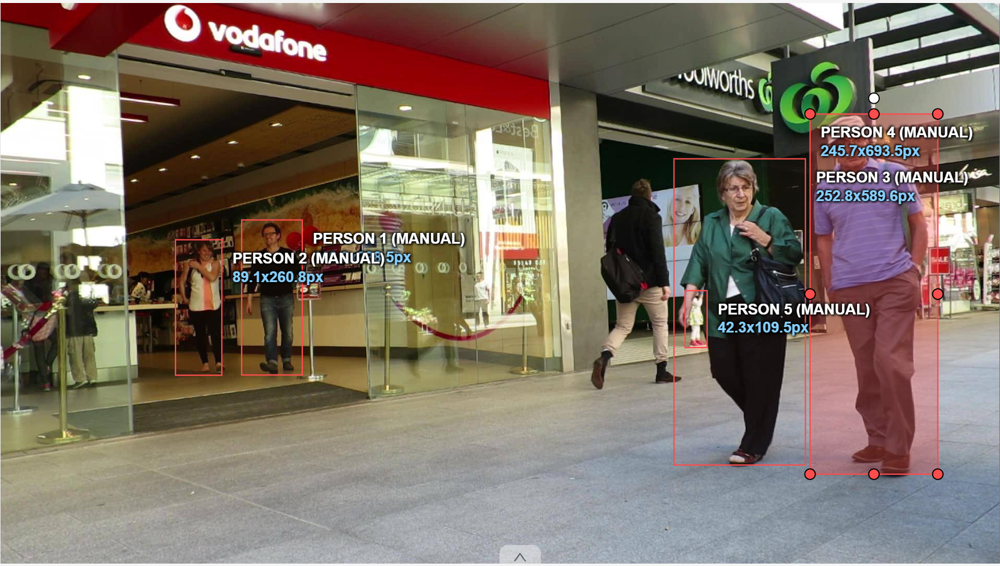
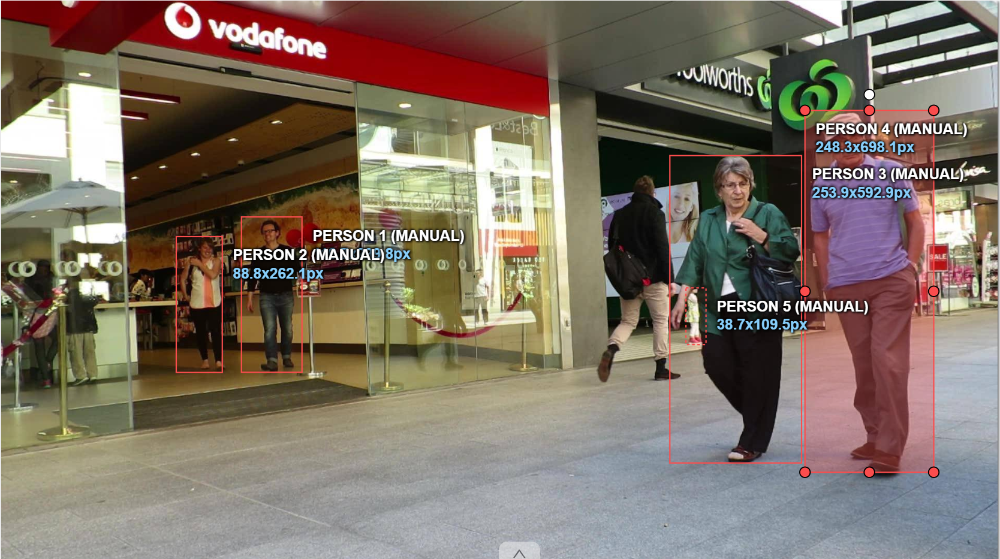
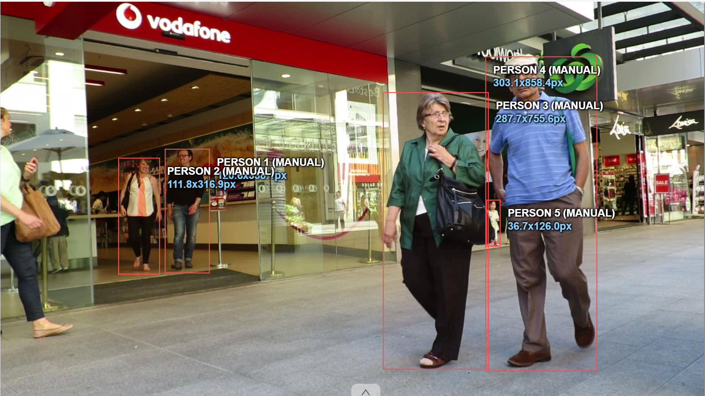

# Báo cáo cá nhân — HoVaTen-MSSV

Đổi tên file theo quy tắc `MSSV_HoTen.md`. Ví dụ: `20241234_NguyenVanAn.md`.

Đoạn video: MOT17-09, 150 frame (frame 1–150), nguồn MOTChallenge, giấy phép CC BY-NC-SA 3.0.

## 0. Thông tin học viên

- Họ tên: Nguyễn Minh Nam Hải 
- MSSV: 2A202603076
- Mã đề (A/B/C): A
- Email: 26ai.hainmn@vinuni.edu.vn
- Link repository: https://github.com/namhai923/K5-L2A-NGUYENMINHNAMHAI-2A202603076-MOTTracking
- Giờ bắt đầu: 16:00
- Giờ kết thúc: 19:00

## 1. Xem trước đoạn video (CP0)

Ghi **trước khi vẽ**, mỗi người một dòng.

| Mã | Frame xuất hiện | Frame cuối thấy được | Rẽ / dừng / đổi tốc độ ở frame | Bị che ở frame | Ghi chú |
|---|---|---|---|---|---|
| P1 | 0 | 149 | 20, 45, 70, 95, 110 | 25–56 | Người áo len đen quần jean, trong cửa hàng Vodafone. |
| P2 | 59 | 149 | 64, 114, 120 | 59–63, 148–149 | Người phụ nữ áo trắng/cam, trong cửa hàng. Tracker nhầm sang người đàn ông có râu ở 44–59, cần kiểm kỹ 56–64. |
| P3 | 0 | 149 | 65, 105 | Không | Bà áo khoác xanh lá, đeo túi đen. Đi cạnh P4 từ ~110, che P5. |
| P4 | 0 | 149 | 45, 95 | Không (chỉ bị mép khung cắt 0–~36) | Ông áo xanh dương, đội mũ. |
| P5 | 0 | 146 | 40 | 108–110, 111–135 (khuất hẳn), 136–137, 145–146, từ 147 (khuất hẳn) | Bé gái váy hoa, giày đỏ. Khuất 25 frame (≤ 60), giữ cùng track. |


## 2. Keyframe và thời gian (CP1, CP4)

Số keyframe lấy từ kết quả `src/check_submission.py`.

| Mã | Số keyframe | Keyframe ở frame | Số frame có mặt | Keyframe / 100 frame | Thời gian (phút) | Chỗ khó |
|---|---|---|---|---|---|---|
| P1 | 11 | 0, 13, 20, 25, 57, 65, 80, 87, 102, 146, 149 | 150 | 7,3 | … | Bị người quần kaki che 25–56; dừng nhiều lần và quay về phía camera ~95–110 |
| P2 | 7 | 59, 64, 70, 95, 120, 148, 149 | 91 | 7,7 | … | Hiện ra sau khung kính ở frame 59, dễ nhầm với người đàn ông có râu đứng cùng chỗ (44–59); bị che 148–149 |
| P3 | 7 | 0, 49, 79, 109, 124, 138, 149 | 150 | 4,7 | … | Lại gần camera, box to nhanh từ ~105 |
| P4 | 7 | 0, 9, 25, 70, 99, 128, 149 | 150 | 4,7 | … | Bị mép phải khung cắt 0–~36; đi sát P3 từ ~110 |
| P5 | 11 | 0, 10, 33, 58, 107, 108, 110, 136, 138, 145, 146 | 122 | 9,0 | … | Box nhỏ; khuất hẳn 111–135 và từ 147; bật/tắt occluded nhiều lần (108–110, 136–137, 145–146) |
| **Tổng** | **43** | | **663** | **6,5** | … | |

Keyframe / 100 frame của cả bài = tổng keyframe ÷ tổng số frame có mặt × 100 = 43 ÷ 663 × 100 ≈ **6,5**

Bạn đặt keyframe nhiều nhất ở người nào? Vì sao (người đó rẽ, dừng, lại gần camera hay bị che)?

P1 và P5 cùng có nhiều keyframe nhất (11). Tính theo mật độ thì P5 dày nhất (9,0 keyframe / 100 frame).
- **P5** bị che rồi hiện lại nhiều lần: bị P3 và người quần kaki che 108–135, rồi bị P4 che từ 145. Mỗi lần bật hoặc tắt occluded/outside cần một keyframe mới, và cần keyframe ngay trước khi bị che và ngay sau khi hiện lại.
- **P1** dừng rồi đi tiếp nhiều lần (20, 45, 70, 95), sau đó quay về phía camera ở ~110. Box nội suy dễ đi trước hoặc sau người nên phải thêm keyframe ở các chỗ đổi tốc độ.
- **P3 và P4** đi khá thẳng và đều nên chỉ cần 7 keyframe.

...

## 3. Đoạn bị che (CP2)

Người bị che: `P5`

| Mốc | Frame |
|---|---:|
| Bắt đầu bị che một phần (bật `occluded`) | 108 |
| Mất hẳn (bật `outside`) | 111 |
| Hiện lại (tắt `outside`) | 136 |
| Thấy rõ trở lại (tắt `occluded`) | 138 |

- Thời gian khuất hẳn: 25 frame (111–135) = 0,83 giây.
- Quyết định: giữ cùng ID.
- Lý do:
  1. **Khuất bao lâu:** 25 frame, dưới ngưỡng 60 frame (2 giây) của lớp.
  2. **Ngoại hình:** khớp. Vẫn là bé gái váy trắng hoa xanh, giày đỏ, cùng chiều cao box (~125 px).
  3. **Chỗ hiện lại:** đúng vị trí cũ. Trước khi khuất, bé đứng yên cạnh người lớn ở cửa Woolworths (x ≈ 1337) từ frame ~40. Khi hiện lại ở frame 136, bé vẫn đứng gần như cùng chỗ (x ≈ 1344). Bé bị P3 và người quần kaki đi ngang phía trước che, không phải tự di chuyển đi.

Ảnh chụp màn hình:






## 4. Tự review ID (CP3)

Lượt 1 theo người (đi ngược từ frame 149 về 0 trên CVAT), lượt 2 theo cảnh (nhảy 10 frame). Ít nhất 3 dòng; không có lỗi thì ghi một dòng "đã kiểm hai lượt, không lỗi".

Loại lỗi dùng đúng một trong 7 mã: `id_switch`, `fragmentation`, `lost`, `merge`, `false_track`, `drift`, `flag`.

| Frame | Mã người | Loại lỗi | Mô tả một câu | Phát hiện ở lượt | Đã sửa? |
|---:|---|---|---|---|---|
| 59 | P2 | `id_switch` | Track ở chỗ P2 bám người đàn ông có râu ở 44–58 rồi mới chuyển sang P2 từ ~59, nên đầu track là người khác. | 1 | Có: cho P2 bắt đầu từ frame 59, bỏ đoạn 44–58 |
| 45 | P2 | `false_track` | Một box thừa chỉ bao nửa trên người nằm chồng lên box chính ở chỗ P2 (45–64). | 2 | Có: bỏ box thừa |
| 25 | P1 | `drift` | Trong đoạn bị che 25–56, box nội suy thẳng giữa frame 24 và 57 bị lệch khỏi P1 khi P1 dừng rồi đi tiếp. | 1 | Có: giữ vị trí ngang theo người ở từng frame |
| 138 | P5 | `flag` | Bật `occluded` thừa ở 138–144 vì box P4 chồng lên, trong khi bé vẫn thấy rõ hoàn toàn. | 2 | Có: tắt `occluded` ở 138–144 |

Tổng hợp số lỗi theo loại:

| `id_switch` | `fragmentation` | `lost` | `merge` | `false_track` | `drift` | `flag` |
|---:|---:|---:|---:|---:|---:|---:|
| 1 | 0 | 0 | 0 | 1 | 1 | 1 |

Lỗi nào chỉ lượt 2 (theo cảnh) mới thấy, lượt 1 (theo người) không thấy? Vì sao?

Lỗi `false_track` ở P2 (frame 45) và lỗi `flag` ở P5 (frame 138) chỉ thấy ở lượt 2. Khi lọc theo một ID ở lượt 1, CVAT chỉ hiện box của người đó. Box thừa nằm chồng lên P2 và box P4 chồng lên P5 bị ẩn đi, nên không thấy có hai box ở cùng một người. Cũng không thấy được box của người khác chỉ chồng lên chứ không thật sự che. Nhìn toàn cảnh mới thấy các box liên quan với nhau.

...

## 5. File xuất và kết quả tự kiểm (CP4)

| Kiểm tra | Kết quả |
|---|---|
| Tên file MOT 1.1 | `NguyenMinhNamHai_mot.zip` |
| Tên file CVAT for video 1.1 | `NguyenMinhNamHai_cvat_video.zip` |
| Số track ID khác nhau trong `gt/gt.txt` (phải là 5) | 5 |
| Frame `outside` không có dòng trong `gt.txt` (đúng / sai) | Đúng |
| Job đã completed trên CVAT máy cá nhân | Có |

Dán phần tóm tắt in ra từ `src/check_submission.py`:

```text
Số frame in theo CVAT (bắt đầu từ 0). Trong gt.txt, frame_id = frame CVAT + 1.

=== File MOT 1.1: NguyenMinhNamHai_mot.zip ===
  Số track ID: 5   |   Tổng số box: 663
  [OK]        Đúng 5 track ID.

  Track | Frame có mặt | Số frame | Đoạn vắng (outside)
      1 |   0–149      |      150 | -
      2 |   0–149      |      150 | -
      3 |   0–149      |      150 | -
      4 |   0–146      |      122 | 111–135
      5 |  59–149      |       91 | -


=== File CVAT for video 1.1: NguyenMinhNamHai_cvat_video.zip ===

  Track | Nhãn   | Frame thấy | Keyframe | KF/100 frame | Frame occluded | Lần bật outside
      0 | person |        150 |       11 |          7.3 |             32 |               0
              Track 0: keyframe ở frame [0, 13, 20, 25, 57, 65, 80, 87, 102, 146, 149]
      1 | person |         91 |        7 |          7.7 |              7 |               0
              Track 1: keyframe ở frame [59, 64, 70, 95, 120, 148, 149]
      2 | person |        150 |        7 |          4.7 |              0 |               0
              Track 2: keyframe ở frame [0, 49, 79, 109, 124, 138, 149]
      3 | person |        150 |        7 |          4.7 |              0 |               0
              Track 3: keyframe ở frame [0, 9, 25, 70, 99, 128, 149]
      4 | person |        122 |       11 |          9.0 |              7 |               2
              Track 4: keyframe ở frame [0, 10, 33, 58, 107, 108, 110, 136, 138, 145, 146]

  Tổng: 43 keyframe / 663 frame có mặt = 6.5 keyframe / 100 frame
  [OK]        Đọc được 5 track từ annotations.xml.

=== Tóm tắt ===
  Lỗi: 0   |   Cảnh báo: 0
  Đạt. Dán phần tóm tắt này vào báo cáo mục 5.
```

## 6. Ba câu kết

1. Nếu được gán lại, bạn sẽ đặt keyframe khác ở đâu? Vì sao?

   Thêm keyframe ở P1 frame 45 và 110, P2 frame 114, P4 frame 45. Đây là các chỗ người dừng hoặc quay về phía camera nằm giữa hai keyframe cách xa nhau. Nội suy tuyến tính giả định vận tốc đều nên box bị trôi ở đó.

2. Có chỗ nào bạn không chắc "cùng ID hay ID mới"? Bạn đã quyết định và ghi chú thế nào?

   P5 khuất hẳn ở 111–135. Tôi giữ cùng ID vì bé khuất 25 frame (< 60), ngoại hình khớp và hiện lại đúng chỗ cũ. Đã ghi ở mục 3.

3. Một lỗi ID trong job của bạn (nếu không còn sót, chọn lỗi đã sửa) có thể làm xe tự lái dự đoán sai chuyển động của người đó như thế nào? Lỗi đó ảnh hưởng MOTA hay IDF1 nhiều hơn?

   Lỗi `id_switch` ở P2, frame 59 (đã sửa): track nối người đàn ông đứng yên với P2 đang đi. Xe sẽ thấy một người đứng yên rồi đột ngột nhảy vị trí, nên ước lượng sai vận tốc và hướng đi. Lỗi này ảnh hưởng IDF1 nhiều hơn. MOTA chỉ trừ 1 IDSW, còn IDF1 tính sai danh tính cho cả 15 frame bị nhầm.

## Bonus (nếu làm)

### B1 — Hai người đi sát

...

### B2 — So cách đặt keyframe

| Cách đặt | Số keyframe | Frame trôi nhất | Ghi chú |
|---|---:|---:|---|
| Đều mỗi 30 frame | | | |
| Theo chỗ đổi hướng | | | |

...

### B3 — So với tracker có sẵn

| Frame | Mã người | Tracker làm gì | Nhãn của bạn | Giải thích (đoán rồi sửa / ghép IoU / box score thấp / ngoại hình) |
|---:|---|---|---|---|
| | | | | |
| | | | | |

## 7. Tài liệu tham khảo và công cụ AI đã dùng

Dùng Claude hỗ trợ viết report.
